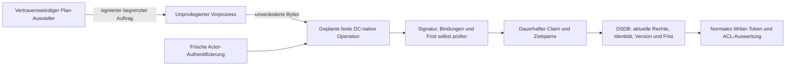

# Samba-CAS-Broker: Ausführungsgrenze und Auftragsabsicherung

Folgestand: Die [native DC-Laboroperation](samba-native-cas-lab.md) implementiert
inzwischen den hier entworfenen begrenzten Samba-Einstieg mit eigenen Tests.
Die folgenden Aussagen über noch nicht gebauten nativen Code beschreiben den
früheren Entwurfsstand; eine Betriebsfreigabe folgt auch aus dem Folgestand nicht.

Stand: 3. November 2026, development. Ausschließlich synthetisches, netzloses
Labor; keine Produktionsverbindung, MOBILE01 ausgeschlossen. CAS-Sperre und
Default-off bleiben bestehen. Keine Identity-Anbindung oder Frameworkänderung.

## Entscheidung und Freigabegrenze

Der getrennte privilegierte Python-Dienst mit direktem Zugriff auf `sam.ldb`
wird als Betriebsarchitektur verworfen. Ein normales AD-Token begrenzt seine
regulären Schreibaufrufe, aber keinen Angreifer mit Kontrolle über den Prozess.
Das zeigt bereits die SYSTEM-Gegenprobe der [Mechanismusuntersuchung](samba-cas-broker-research.md).

Bevorzugter weiterer Entwurf ist eine kleine, überprüfbare **DC-native feste
Operation** innerhalb der ohnehin vertrauenswürdigen Samba-Ausführung. Sie muss
den normalen delegierten Writer-Kontext, frische Actor-Autorisierung und die
lokale DSDB-Transaktion erhalten. Keine allgemeinen LDB-, SYSTEM-, DN-, Filter-,
Control-, Dateipfad- oder Shellparameter. Das reduziert den zusätzlichen
Angriffsraum, beweist aber allein noch keine sichere Implementierung. Hier wird
kein Samba-Modul gebaut, kein OID vergeben und kein Endpunkt eingerichtet.

Ein unprivilegierter Vorprozess kann begrenzte Frames annehmen und vorprüfen.
Er erhält weder DB-Dateirechte noch Signierschlüssel, Writer-/Actor-Secrets oder
Journalzugriff. Der vertrauenswürdige Teil muss trotzdem alle Eingaben selbst
erneut prüfen. Eine Freigabeentscheidung aus dem Vorprozess ist keine Autorität.

Das Diagramm ist der Zielentwurf, kein installierter Dienst. Die neue Python-
Probe implementiert den Auftragsvertrag vor dem bestehenden Laborkandidaten;
die UID-Isolationsprobe ist ein separater Kindprozess. Es gibt noch keinen
integrierten Transport zwischen diesen Komponenten und keinen Nachweis gegen
eine Kompromittierung des privilegierten Kandidaten.

## Vertrauens- und Rechtevertrag

| Komponente | Erlaubte Befugnis | Verbot / offener Nachweis |
| --- | --- | --- |
| Plan-Aussteller | Nach frischer Anmeldung und Bestätigung genau einen kanonischen Auftrag signieren | Kein vom Browser bestimmter Actor oder Schlüssel; produktive Step-up-/Plan-Anbindung und Schlüsselspeicher noch offen |
| Vorprozess | Höchstens 8192 Payloadbytes plus feste 64-Byte-Signatur prüfen/weiterreichen | Keine DB, Secrets, Journal, ergänzende Gruppen oder Linux-Capabilities |
| DC-native Operation | Gepinnter öffentlicher Ausstellerschlüssel, feste Policy und Audience; normale Writer-ACLs | Kein SYSTEM-Fallback; nativer Einstieg und vollständige Parser-/IPC-/Hosthärtung noch offen |
| Actor | Frisch authentifizierte SID, aktuelle Operatorrolle im Transaktionsstand | Signatur ersetzt weder Passwortnachweis noch aktuelle Rolle |
| Journal | Dauerhafter ID-/Actor-/Inhaltsclaim und Sperre unklarer Ziele | Client darf keinen Pfad, Namespace, Reset oder Entsperrung wählen |

Der Laborvorprozess startet per `spawn`, also ohne geerbte SamDB-Objekte. Vor
dem Lesen von Testeingaben setzt er UID/GID 65534, entfernt alle Zusatzgruppen,
setzt `no_new_privs`, Corelimit 0, CPUlimit 2 Sekunden und FD-Limit 32. Gemessen
werden UID, leere Gruppen, effektive Capabilities 0 sowie `NoNewPrivs: 1`.
Öffnen zum Lesen **und** Schreiben von DC-Datei, privatem Signierschlüssel,
Journal und beiden Fixture-Credentialdateien scheitert mit PermissionError.

Das ist eine konkrete Dateizugriffsgrenze, keine vollständige Sandbox:
Netzwerkzugriff, ptrace, Systemaufruffilter, Mountsicht, fremde FDs und globale
Lastbegrenzung werden hier nicht als isoliert behauptet. `no_new_privs` verhindert
Privileggewinn bei exec, ersetzt jedoch keine allgemeine Zugriffskontrolle.
[Linux-Kernel-Dokumentation](https://www.kernel.org/doc/html/latest/userspace-api/no_new_privs.html).
Produktiv wären eigene Dienst-UIDs statt der gemeinsamen UID 65534 erforderlich.

## Signierter Auftragsvertrag der Laborprobe

`broker_envelope.py` prüft Ed25519 über das vorhandene OpenSSL. Es gibt genau
einen durch den vertrauenswürdigen Testaufbau gepinnten öffentlichen Schlüssel;
Algorithmus, Schlüsselpfad und Programm sind keine Requestfelder. Der private
Testschlüssel entsteht frisch im Container in einem privaten Verzeichnis und
wird nicht an den Vorprozess übergeben. Der Testaussteller ist kein fertiger
Authentifizierungs- oder Schlüsselverwaltungsdienst.

Die signierten Bytes sind kanonisches ASCII-JSON: sortierte Schlüssel, feste
Separatoren und Escape-Schreibweise. Doppelte JSON-Schlüssel, zusätzliche Felder,
abweichende Kanonisierung, falsche Signaturlänge und Payloads über 8192 Bytes
werden abgewiesen. Verifikation verwendet private temporäre Dateien, feste
Argumente, bereinigte Umgebung, keinen Shellaufruf und drei Sekunden Timeout.
Fehler führen zu keiner Mutation. OpenSSL-Prozessstart und Python-JSON-Parser
bleiben Angriffsfläche der Laborprobe; ein nativer minimaler Parser ist offen.

Die Hülle bindet:

- den vollständigen bisherigen Request: ID, Ziel-GUID/SID, Domain-GUID,
  DC-Invocation-ID, erwartete USN und alle Änderungen;
- die authentifizierte Actor-SID;
- `policy=profile-lab-v1` und `audience=profile.test/dc1/local-cas`;
- ganzzahlige Ausgabe- und Ablaufzeit, maximal 60 Sekunden Lebensdauer.

Es gilt `issued <= now < expires`. Die Frist wird vor der Anmeldung und erneut
**in der lokalen Transaktion unmittelbar vor Modify** geprüft. Ausstellungszeit
in der Zukunft, abgelaufene oder überlange Frist und boolesche Zeitwerte werden
abgewiesen. Ein vertrauenswürdiger lokaler Callback realisiert nur diese zweite
Prüfung im Kandidaten; er ist kein übertragbares Requestfeld. Ein sicherer
Betrieb benötigt zusätzlich vertrauenswürdige Zeit, Umgang mit Zeitsprüngen,
begrenztes Warten auf Locks und Worker-/Watchdog-Regeln. Diese fehlen weiterhin.

Die Signatur ist eine Freigabe des exakten Inhalts, kein übertragbarer Beweis
einer frischen Benutzeranmeldung. Die Probe verlangt zusätzlich erneut echten
LDAPS-Bind mit CA-/Namensprüfung und vergleicht die authentifizierte SID. Der
bestehende Kandidat prüft anschließend Writer, Actorrolle, Zielschutz, OU,
Domain/DC und Version erneut innerhalb der DSDB-Transaktion. Zwischen Gate und
Kandidat wird im Labor bewusst zweimal authentifiziert; keine Passwortspeicherung
und kein produktiver Session-/Actor-Proof-Transport werden dadurch eingeführt.

Signaturen verschlüsseln keine Profilwerte. Die Hülle darf weder ins normale
Audit noch in Fehlerlogs gelangen; der spätere Transport muss Vertraulichkeit
und gegenseitige Authentifizierung liefern. In der Probe bleiben temporäre
Hüllen privat und werden entfernt. Senderzertifikate, Kanalbindung, Rotation,
Widerruf und persistente Ausstelleridentität sind separate offene Betriebsgates.

## Replay, Unklarheit und Rückweg

Die Operations-ID bleibt die einzige persistente Wiederholungsidentität; ein
neuer Nonce-/Token-Speicher wird nicht neben dem Journal erfunden. Gleicher
signierter Auftrag liefert nach erneutem Öffnen von Gate/Kandidat den gespeicherten
Zustand, ohne neue USN. Gleiche ID mit geändertem Inhalt bleibt auch bei gültiger
neuer Signatur gesperrt. Unklares `applying` sperrt ebenfalls neue IDs desselben
Ziels. Ein abgelaufener Auftrag wird abgewiesen, auch wenn die ID bekannt ist;
eine spätere reine Statusabfrage wäre eine eigene autorisierte Operation.

DSDB-Commit und Journalabschluss bleiben getrennte Commits. Die neue Signatur
behebt keinen Ergebnisverlust. Der Test nach echtem Commit mit injiziertem
Bestätigungsfehler erhält `applying`, verhindert Replay und blockiert einen neu
signierten Auftrag auf das Ziel. Kein SQL-Reset, automatischer Retry, Löschen
eines Journals oder Namespacewechsel als Wiederanlaufverfahren.

Abbruch wegen abgelaufener Frist innerhalb der Transaktion hinterlässt nach
bestätigtem Cancel `failed_no_effect`. Eine Wiederholung derselben ID schreibt
nicht erneut. Fachliche Rücknahme bleibt ein neuer bestätigter Gegenauftrag
mit frischer Version, aktueller Autorisierung und eigenem Audit. Die ursprünglichen
vier Profilwerte und temporär entfernte Operatorrolle werden im Harness exakt
wiederhergestellt; USN und AD-Historie bleiben erhalten. Keine Produktivbackups
oder allgemeine Restore-Abnahme werden behauptet.

Rückweg dieser Entwicklung: die zusätzliche Boundary-Testausführung und die
beiden neuen Labordateien können auf den vorherigen Developmentstand zurückgenommen
werden; die einzige Kandidatenerweiterung ist der optionale lokale Fristcallback.
Kein Runtime-Rollback, keine Migration, Dienständerung, Installation oder CAS-
Entsperrung ist erforderlich. Bei fehlgeschlagenen Tests stoppt `run.sh` mit
Fehler und beendet den synthetischen DC; Produktionspfade sind nicht erreichbar.

## Nachweise und verbleibende Gates

Samba 4.17.12-Debian / OpenSSL 3.0.22 im bestehenden gepinnten Image, `--network
none`, keine Ports, ausschließlich zwei read-only Mounts wie bisher. `run.sh`
führt nach Go-Samba/Executor und den 18 Brokerverträgen neun neue Verträge aus:

| Vertrag | Nachweis |
| --- | --- |
| 01 Erfolg und erneutes Öffnen | Signierter Auftrag erfolgreich; Wiederholung ohne USN-Änderung |
| 02 Bindung sämtlicher Felder | Einzelne Request-/Hüllenfelder, Signatur und anderer Schlüssel abgewiesen |
| 03 Kontext / Lebensdauer | Auch gültig signierte falsche Audience, Policy, Actor, Zukunft und Fristen abgewiesen |
| 04 Parser / Frame | Größe, Länge, Syntax, Duplikate, zusätzliche Schlüssel und nichtkanonische Bytes abgewiesen |
| 05 Frische Anmeldung | Falsches Passwort tatsächlich LDAP 49; anderer angemeldeter Benutzer abgewiesen |
| 06 Replay / unklarer Commit | Gleiche ID ohne Ausführung, geänderter Inhalt und frische ID für unklaren Zielclaim gesperrt |
| 07 OS-Dateigrenze | Unprivilegierter Kindprozess kann alle fünf Autoritätsdateien weder lesen noch beschreiben |
| 08 Ablauf beim Schreiben | Simulierter Zeitfortschritt zwischen Gate und Transaktion verhindert Änderung |
| 09 Frische Rolle | Nach Signierung entzogene Operatorrolle verhindert Änderung; Rolle wiederhergestellt |

Alle Ablehnungshelfer vergleichen den Zielversionssnapshot davor/danach; der
USN-Vergleich ergänzt die bestehenden expliziten Werte-/Transaktionsnachweise.
Die CI prüft Python-Syntax und führt die erweiterte Matrix automatisch aus.

Lokaler Abschluss: alle neun neuen und 18 bisherigen Brokerverträge sowie die
bisherige Go-Samba-/CAS-/Executor-Matrix bestanden. Python- und Shellsyntax,
Whitespace und unveränderte Runtime-/Moduldateien geprüft. Der erste neue
Testaufbau verwendete versehentlich eine Base-Suche auf der OU; vor dem
erfolgreichen vollständigen Wiederholungslauf auf Onelevel korrigiert.

**Noch keine sichere Betriebsfreigabe:** nativer eng begrenzter Samba-Einstieg,
authentifizierter/vertraulicher Transport, Identity-Plan/Step-up/Actor-Proof,
verschlüsseltes Journal und vollständiges Audit der Freigabe/Ablehnung, harte
Ende-zu-Ende-Limits, Schlüsselwechsel/Widerruf, Crash-/Stromausfall-/Restore-
Nachweise und Mehr-DC-/Replikationsverhalten fehlen. UID-Test, Signatur und
Ein-DC-Transaktion dürfen diese Gates nicht ersetzen. Nächster getrennt zu
beauftragender Schritt ist der Review des nativen Operationsvertrags und seiner
Identity-Anbindung; keine automatische Installation oder Aktivierung.
