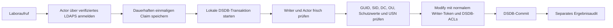

# Serverseitiger Samba-CAS-Broker: Laborbefund und Sicherheitsgrenzen

Stand: 2. November 2026, development. Keine Produktionsverbindung oder -änderung,
MOBILE01 vollständig ausgeschlossen. Identity-Runtime, FF-Kodierung, CAS-Sperre,
Framework, Abhängigkeiten und Produktivkonfiguration bleiben unverändert.

## Entscheidung

**Ein lokaler DSDB-Mechanismus ist im Labor positiv nachgewiesen:** Auf genau
einer Samba-Instanz lassen sich aktuelle Autorisierung, Zielidentität,
Objektversionsvergleich und Attributänderung in einer lokalen Transaktion
ausführen. Ein normales delegiertes Writer-Token durchläuft dabei die
Samba-Attribut-ACLs. ABA und andere Objektänderungen werden erkannt; der lokale
Transaktionslock serialisiert auch einen bereits angemeldeten LDAP-Schreiber.

**Ein sicher betreibbarer Brokerdienst ist damit noch nicht abgenommen.** Der
Prozess benötigt direkten Zugriff auf DC-Datenbankdateien. Eine Kompromittierung
dieses Prozesses könnte diese Hostbefugnis zur Umgehung der normalen AD-Token-
Grenze nutzen. Die SYSTEM-Gegenprobe demonstriert das ausdrücklich. Das
Laborskript ist kein Installationskandidat und kein begründet privilegienarmer
separater Dienst. Es gibt keinen Listener, keine Unit und keine Identity-Anbindung.
Die bestehende CAS-Sperre bleibt bestehen.

Die frühere [LDAP-CAS-Untersuchung](samba-cas-research.md) gilt weiterhin für den
delegierten LDAP-Schreibweg. Der neue positive Befund verwendet die lokale
DSDB-Schnittstelle und damit eine andere Vertrauens- und Betriebssystemgrenze.
Er darf nicht als nachträgliche Unterstützung des LDAP-Assertion-Controls
ausgegeben werden.

## Aufbau der Mechanismusprobe

Dateien: `scripts/ad-profile-lab/broker_candidate.py` und `broker_research.py`.
Sie laufen ausschließlich im vorhandenen frischen, netzlosen Samba-Labor mit
festem Testpfad, festem Testrealm und ausschließlich Loopback-Interface. Der
Kandidat hat genau ein aufgenommenes Testziel `casprobe`; kein allgemeiner
Verzeichnisdienst und keine neue Stufe-1-Bedienoberfläche entstehen hier.

Die Actor-Anmeldung erfolgt vor dem lokalen Schreiblock. Verwendet wird ein
normaler Simple Bind über LDAPS mit CA-/Namensprüfung. Es wird keine Bind-
Verbindung bei gehaltenem DSDB-Lock aufgebaut. Der Transaktionsabschnitt liest
Actor-Kontostatus und direkte Operatorgruppenmitgliedschaft erneut und bindet
die Gruppe an ihre GUID.

Der Broker konstruiert intern ausschließlich den festen delegierten Writer-
Kontext. Writer-SID und -GUID sind in der frisch erzeugten Laborfixture gepinnt;
Kontostatus und Token werden beim Start und erneut in der Transaktion geprüft.
SYSTEM, Administrator-SIDs und Restore-/Security-/Take-Ownership-Privilegien
werden abgewiesen. Es gibt keinen Fehlerpfad, der eine abgewiesene Änderung als
SYSTEM wiederholt. `user_session` ist lediglich Tokenbildung und **keine**
Passwortauthentifizierung; die getrennte Actor-Authentifizierung darf dadurch
nicht ersetzt werden. Die API und ihre Implementierung zeigen diese Trennung.
[Samba-Primärquelle pyauth.c](https://raw.githubusercontent.com/samba-team/samba/master/source4/auth/pyauth.c).

Requestfelder sind fest: Operations-ID, Ziel-GUID/-SID, Domain-GUID,
DC-Invocation-ID, erwartete uSNChanged und Änderungen an den vier Profilattributen.
Freie DNs, Filter, URLs, Controls, Operationstypen oder Sessionobjekte werden
abgewiesen. Domain/DC müssen mit der festen Konfiguration und den tatsächlich
gelesenen Objekten übereinstimmen. Das Ziel wird anhand GUID unmittelbar in der
festen OU gesucht; Version und Schutzwerte werden innerhalb derselben lokalen
Transaktion gelesen. Das Labormodell verbietet unter anderem Gruppenmitgliedschaft,
SPNs, SID-History, Key-Credentials und Delegationseigenschaften.

Die normale Mutation läuft durch `SamDB` und den DSDB-Modulstack, nicht durch
einen rohen Datenbankeditor. Das ACL-Modul unterscheidet den Sicherheitskontext;
SYSTEM-Pfade besitzen weitergehende Befugnisse. Die konkreten positiven und
negativen Rechteaussagen dieser Untersuchung stützen sich auf die gemessene
Samba-Version, nicht allein auf den Quelltextstand von master.
[Samba-Primärquelle acl.c](https://raw.githubusercontent.com/samba-team/samba/master/source4/dsdb/samdb/ldb_modules/acl.c).

## Least Privilege: was belegt ist und was offen bleibt

| Grenze | Belegt | Einschränkung / nächstes Gate |
| --- | --- | --- |
| Delegierte Attributrechte | Dieselben vier objektbezogenen Write-Property-ACEs wie bisher; Description/UAC/SPN sowie Ziel außerhalb der OU liefern LDAP 50 | Kein vollständiger Beweis sämtlicher effektiver AD-Rechte, etwa sonstiger Domänenstandardrechte oder Maschinenkontoquoten |
| Effektive Rechte beim Schreiben | ACL-Entzug nach Planung wird auch mit frisch gelesener Version abgewiesen; ursprünglicher Descriptor wird exakt wiederhergestellt | Weitere ACL-/Vererbungs-/Deny-/Owner-Fälle vor Freigabe erforderlich |
| Actor | Echter LDAPS-Bind, falsches Passwort und Nichtoperator abgewiesen; aktueller Rollenentzug wirkt | Noch kein produktives Transport-, Actor-Proof-, Session-/Step-up-, Rate-Limit- oder Schlüsseldesign |
| Writer | Feste SID/GUID, normales Token; Kontosperre wirkt auch auf bereits angelegten Kandidaten | Tokenbildung benötigt die Host-Vertrauensstellung; keine Entgegennahme fremder Tokens zulassen |
| Ziel | Ein fest aufgenommenes GUID-Ziel; frische SID-/OU-/Schutzprüfung; SPN, privilegierte Mitgliedschaft und OU-Wechsel sperren | Keine vollständige Produktionsprüfung von Trusts, verdeckten Attributen, beliebigen Gruppenpfaden oder allen Kontotypen |
| Host / Prozess | Kein neuer Zugriff außerhalb des Containers, keine zusätzlichen Docker-Privilegien | Lokaler DB-Zugriff ist DC-vertrauenswürdig. Ein separater Root-/DB-Owner-Prozess ist dadurch noch nicht hostseitig Least Privilege |

Der bewusst unsichere SYSTEM-Kontrollfall kann Description in einer anschließend
abgebrochenen Testtransaktion ändern, während dasselbe normale Writer-Token
daran scheitert. Er macht die Kompromittierungsgrenze sichtbar. Das bloße Setzen
eines Benutzer-Tokens im normalen Code ist keine Betriebssystemisolation gegen
einen Angreifer, der diesen privilegierten Prozess kontrolliert.

Für eine weitere Architekturprüfung ist daher ein begrenzter DC-nativer
Operationseinstieg mit nachgewiesener authentifizierter Identität und unverändertem
ACL-Modulpfad zu prüfen. Ein zusätzlicher privilegierter Python-HTTP-/SSH-Wrapper
oder beliebiger lokaler LDB-Zugriff wird nicht zur Aktivierung empfohlen. Ein
solcher nativer Baustein wurde hier weder in Samba implementiert noch installiert.

## Gemessene Testmatrix

Samba **4.17.12-Debian**, OpenSSL **3.0.22**, dieselbe gepinnte Debian-Basis wie
im bestehenden Labor. Die 18 Brokerverträge sind echte DSDB-/LDAP-/Prozessproben:

| Test | Ergebnis |
| --- | --- |
| 01: Profiländerung, neuer Gegenauftrag und Wiederholung | Erfolg; erledigte ID ändert weder Werte noch USN erneut |
| 02: ABA und fremde Attributänderung | Erwartete Objektversion wird abgewiesen; fremder Wert bleibt erhalten |
| 03: Zwei unabhängige Brokerprozesse | Eine Version, genau ein Erfolg und ein Versionskonflikt |
| 04: Verbotene Attribute und fremde OU | Echte DSDB-ACL liefert 50; vorangehende Profiländerung wird durch Transaktionsabbruch verworfen |
| 05: Request-/Identitätsmanipulation | Zusätzliche Felder, falsche GUID/SID/Domain/DC und fremdes Attribut abgewiesen |
| 06: Passwort und Operatorrolle | Falsches Passwort beziehungsweise gültiger Nichtoperator nicht zugelassen |
| 07: Rollenentzug | Vorbereiteter Aufruf nach Entfernen der Operator-Mitgliedschaft abgewiesen; Mitgliedschaft wiederhergestellt |
| 08: Echter Prozessabbruch vor/nach Commit | Vor Commit bleiben Zielwerte und Version unverändert; nach Commit bleibt die Wirkung erhalten. In beiden Fällen keine Wiederholung des Claims |
| 09: Idempotenz und Auditinhalt | Gleiche ID mit anderem Inhalt oder Actor abgewiesen; Audit ohne Passwort und Profilwerte |
| 10: Externer LDAP-Schreiber | Bereits angemeldeter unabhängiger Prozess wird während der lokalen Transaktion blockiert und schließt erst danach ab |
| 11: Entzug der konkreten Write-Property-ACEs | Auch bei neu gelesenem Versionsstand LDAP 50; Descriptor bytegenau zurückgesetzt und Rechte wieder wirksam |
| 12: Schutz-/Scopeänderung | Nach SPN-Zuweisung oder Verschieben aus der OU wird nicht geschrieben |
| 13: TLS-Namensabweichung | Namensabweichung abgewiesen; vorheriger TCP-Test bestätigt denselben erreichbaren Loopback-Endpunkt |
| 14: SYSTEM-Kontrollfall | Weitergehende Wirkung demonstriert, Transaktion abgebrochen und SYSTEM-Token im Kandidaten abgewiesen |
| 15: Injizierter Fehler nach Commit | Dauerhafter Claim bleibt unklar; erneuter Aufruf führt keine Änderung aus |
| 16: Writer sperren | Start und bereits vorbereiteter Kandidat abgewiesen; Konto danach wiederhergestellt |
| 17: Aktuelle privilegierte Zielmitgliedschaft | Auch ein frisch gelesener Zielstand ist gesperrt; Mitgliedschaft danach zurückgesetzt |
| 18: Remote-Transaktionswrapper | `transaction_cancel()` auf einer LDAPS-Verbindung macht die bereits ausgeführte Änderung nicht rückgängig |

Test 10 verwendet Prozessbarrieren: Der externe Client ist vor Beginn angemeldet
und kündigt den Modify-Aufruf an. Während der gehaltenen lokalen Transaktion
bleibt er ausstehend; danach erfolgt sein Abschluss. Das ist ein kontrollierter
Ein-DC-Labornachweis, kein Test von Replikationsrennen, Partitionen oder jeder
möglichen Schedulingfolge.

Die Remote-Gegenprobe ist wesentlich: Ein gleichnamiger Python-Methodenaufruf
garantiert keine Transaktion über mehrere LDAP-Requests. In der untersuchten
Primärquelle des LDAP-Backends sind die Transaktionshooks lediglich Platzhalter;
die konkrete Laborprobe bestätigt die fehlende Rücknahme dieses Weges.
[Samba-Primärquelle ldb_ldap.c](https://raw.githubusercontent.com/samba-team/samba/master/lib/ldb/ldb_ldap/ldb_ldap.c).

## Audit, Absturz und Rückweg

Das Laborjournal liegt nur im Container in einem privaten Verzeichnis. Ein
SQLite-Claim wird vor der DSDB-Transaktion dauerhaft gespeichert und an Actor
und Requestdigest gebunden. Profilwerte und Passwörter stehen nicht im Audit.
DSDB-Commit und SQLite-Ergebnis sind weiterhin **zwei getrennte Commits**.
Die Probe behauptet keine gemeinsame ACID-Transaktion über beide Systeme.

Ein Verlust nach Claim, ein Fehler beim Commit beziehungsweise seiner Bestätigung
oder ein Prozessabbruch nach Commit dürfen keinen automatischen zweiten
Schreibaufruf auslösen. Ein hinterlassenes `applying` bleibt in der Probe unklar.
Nur ein bestätigter Abbruch vor Commit wird als `failed_no_effect` abgeschlossen.
Ein unveränderter späterer Lesestand allein entsperrt keinen alten Claim.
Die vorhandenen Identity-Regeln für externe Schreibvorgänge bleiben maßgeblich.
[Auditvertrag](audit-policy.md).

Der positive Gegenauftrag nutzt erneut eine frische Objektversion und das normale
delegierte Writer-Token. Das Laborharness stellt am Ende die ursprünglichen vier
Profilwerte wieder her. Temporäre Änderungen an Rolle, ACL, SPN, OU und
Writerstatus werden jeweils im Test zurückgesetzt; Ziel-ACL wird bytegenau
verglichen. USN und Änderungshistorie werden nicht künstlich zurückgedreht.
Der Container samt Journal und synthetischen Credentials wird entfernt.

Das Journal ist eine Mechanismusprobe, kein vollständiger Betriebs-/Auditdienst:
keine Integration mit den verschlüsselten Identity-Plänen, kein produktives
Retention-/Backup-/Reconciliationverfahren und kein revisionssicherer DC-Audit-
Transport. Schema-/Retention-, Datenverlust- und Replikationsfragen bleiben
Freigabegates. Es wurde kein Produktivbackup erstellt oder als vorhanden behauptet.

## Weiterer sicherer Umfang

Vor einem installierbaren Broker wären mindestens nachzuweisen:

1. DC-native Vertrauensgrenze oder belastbar isoliertes Prozessmodell mit
   minimalem Angriffsraum; kein frei zugänglicher SYSTEM-/LDB-Editor.
2. Authentifizierter, gegen Replay gebundener Request einschließlich Actor,
   Policyrevision, Domain/DC, GUID/SID, erwarteter Version und Änderungsdigest;
   kein vom Client konstruierter Sicherheitskontext. Genaue Rolle von Actor und
   delegiertem Writer festlegen und beide aktuell prüfen.
3. Übernahme des vollständigen Identity-Plan-/Bestätigungs-/Audit-/Rückwegvertrags,
   einschließlich frischer Step-up-Anmeldung, Verschlüsselung und dauerhafter
   Unklarheit ohne Retry. Der Laboraufruf hat noch keine solche Benutzeroberfläche.
4. Normale ACL-Auswertung, lesbare Schutzattribute und effektive Rechte auch bei
   Deny-/Vererbungs-/Gruppen-/SID-History-/Trust-Fällen. Keine erweiterten Rechte
   nur zum Bestehen eines Tests delegieren.
5. Begründete Transaktions-/Abbruch-/Commitfehlersemantik, harte Zeit- und
   Ressourcenlimits, Watchdog, Verfügbarkeit des DC und Replikationsverhalten.
   Kein Netzwerkaufruf bei gehaltenem DSDB-Schreiblock.
6. Mehr-DC-, Replikations-, Failover-, Wiederanlauf-, Last-, Fuzz- und Disk-/Restore-
   Proben. Die feste Invocation-ID darf nicht durch stilles Failover ersetzt werden.

Die bestehende CI führt die Python-Brokerverträge nach der unveränderten Go-
Samba-Schutzmatrix im selben netzlosen Wegwerfcontainer aus. Reproduktion über
die [Stufe-1-Laboranleitung](ad-profile-stage1.md); nur Laborskripte und
Testbinaries werden read-only eingebunden. Die Pythondateien werden zusätzlich
syntaxgeprüft. Keine Quelle des laufenden Identity-Executors wird umgestellt.

Lokaler Abschlussnachweis: alle 18 Brokerverträge und die bestehende Go-Samba-
Forschungs-/Schutz-/Executorprobe im netzlosen Container bestanden. Python- und
Shellsyntax sowie Whitespace geprüft. Go-Runtime, FF-Encoder, Journal,
Executor und go.mod/go.sum sind gegenüber `105afc1` unverändert. Ein realer
Mehr-DC-, Stromausfall-, Produktionsbackup- oder Betriebshärtungsnachweis wird
damit nicht behauptet.
